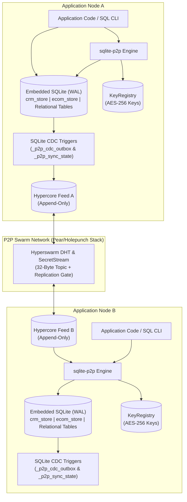

# Technical Architecture: sqlite-p2p

This document describes the architectural foundation, data protocols, and synchronization mechanisms powering the `sqlite-p2p` decentralized database engine.

- **Developer Setup & Usage Guide**: Refer to [README.md](/README.md) for embedding and API instructions.
- **Manual E2E Replication Guide**: Refer to [docs/manual-e2e-replication-test.md](/docs/manual-e2e-replication-test.md) for multi-node CLI and SQL replication workflows.
- **Buzz Nostr Relay Specification**: Refer to [docs/nostr-buzz-agent-spec.md](/docs/nostr-buzz-agent-spec.md) and [docs/nostr-buzz-relay-protocol.yaml](/docs/nostr-buzz-relay-protocol.yaml) for the `wss://` cross-LAN discovery protocol.
- **Vector Search Specification**: Refer to [docs/sqlite_vector_search_extension_specification.md](/docs/sqlite_vector_search_extension_specification.md) for `pkg/vect` K-NN similarity search.

---

## 1. System Topology & Architectural Overview

`sqlite-p2p` is a decentralized, local-first database engine that linearizes mutations across independent peer nodes without centralized servers, brokers, or cloud storage.



---

## 2. Core Architectural Pillars

### 2.1 Pure Go & Zero-CGO Runtime
The entire engine compiles with `CGO_ENABLED=0` using `modernc.org/sqlite`. It contains no C library dependencies, ensuring portability across Linux, macOS, and Windows.

### 2.2 Universal Multi-Table Storage & Schema Auto-Discovery
`sqlite-p2p` supports both schema-agnostic Key-Value tables (`crm_store`, `ecom_store`) and arbitrary relational SQLite tables:

1. **Fast-Path KV Tables**:
   ```sql
   CREATE TABLE IF NOT EXISTS crm_store (
       key TEXT PRIMARY KEY,
       metadata TEXT CHECK(json_valid(metadata)),
       data BLOB
   ) WITHOUT ROWID;
   ```
2. **Schema Auto-Discovery (`internal/store/tables.go`)**:
   - Inspects `sqlite_master` and `PRAGMA table_info(<table>)` on startup and after SQL execution.
   - Automatically excludes SQLite system tables (`sqlite_%`), P2P bookkeeping tables (`_p2p_%`), and the local encryption key table (`crm_keys`).
   - Detects single-column primary keys, composite primary keys (encoded as JSON arrays), and implicit `rowid` tables.

### 2.3 Trigger-Based Change Data Capture (CDC) & Loop Prevention
1. **Trigger Installation (`internal/store/cdc.go`)**:
   - Every tracked user table is outfitted with `AFTER INSERT`, `AFTER UPDATE`, and `AFTER DELETE` triggers (`_p2p_trg_<table>_ins/upd/del`) that write mutations into `_p2p_cdc_outbox`.
   - Relational row payloads are serialized via SQLite `json_object(...)` with binary `BLOB` columns safely wrapped as `{"$blob_hex": "<hex>"}`.
2. **Remote-Apply Loop Prevention Guard (`_p2p_sync_state`)**:
   - Every CDC trigger includes `WHEN (SELECT applying_remote FROM _p2p_sync_state WHERE id = 1) = 0`.
   - When `ApplyChangesetToTable` applies an incoming remote changeset inside a transaction, it sets `applying_remote = 1` before mutating the target table and resets `applying_remote = 0` prior to commit, guaranteeing zero recursive replication loops.
3. **Initial Database Seeding & DDL Replication (`OpDDL`)**:
   - When an existing SQLite database (e.g. `kheti_badi.db` containing `ecom_store`) is opened with an empty `.hypercore` feed, `SeedFromRepository` emits normalized `OpDDL` (`CREATE TABLE IF NOT EXISTS ...`) and `OpInsert` changesets for all discovered tables and rows.
4. **Table-Scoped Last-Write-Wins (LWW) Reconciliation**:
   - `ReplicationEngine` scopes LWW timestamps by composite key `table + "\x00" + key`, ensuring primary keys shared across distinct tables resolve independently.

### 2.4 Cryptographic Shredding
- Payloads are encrypted using authenticated symmetric `AES-256-GCM`.
- Encryption keys are stored in a local `KeyRegistry`.
- Purging a key via `keys.PurgeKey(keyID)` renders all historical and replicated ciphertext permanently unrecoverable, fulfilling GDPR right-to-be-forgotten requirements while maintaining replication causal integrity.

### 2.5 Hybrid Intra-LAN Beacon, HyperDHT & Buzz Nostr Relay (`wss://`) Discovery
- **Always-On Intra-LAN UDP Beacon (`DefaultBeaconPort = 49736`)**: Nodes on the same local network automatically broadcast and discover each other's routable LAN IP and dynamic port without manual configuration, regardless of `cross_lan_mode`.
- **Configurable `cross_lan_mode` (`"dht"`, `"nostr"`, `"both"`, `"none"`)**:
  - `"dht"` (Default): Uses HyperDHT bootstrap seed nodes (`cmd/dht-seed`) over UDP/TCP. When `bootstrap` is empty, nodes operate air-gapped as local DHT roots.
  - `"nostr"`: Uses `NostrDiscoveryClient` ([internal/p2p/nostr_discovery.go](/internal/p2p/nostr_discovery.go)), implementing the `CrossLANDiscoveryClient` interface over WebSocket Secure (`wss://`) to traverse corporate firewalls and separate LANs via a custom domain **Buzz Nostr Relay**.
  - `"both"`: Runs HyperDHT bootstrap and Buzz Nostr Relay (`wss://`) discovery concurrently.
  - `"none"`: Restricts discovery strictly to intra-LAN UDP broadcast beacons and static `peer_addrs`.
- **Nostr Protocol & Dual Cryptographic Identity Binding**:
  - Conforms to **NIP-01** (`EVENT`, `REQ`, `CLOSE`, `EOSE`, `OK`), **NIP-33** (`kind: 30078` Parameterized Replaceable Events tagged with `["d", "sqlite-p2p:<topic_hex>"]` and `["t", "<topic_hex>"]`), **NIP-40** (`expiration` TTL), **NIP-09** (`kind: 5` deletion on `Engine.Close()`), and **NIP-42** (`kind: 22242` client authentication).
  - Deterministically derives a 32-byte `secp256k1` Nostr keypair from `sha256("sqlite-p2p:nostr:v1:" || KeyPair.Private[:])` for BIP-340 Schnorr event signing, and embeds an `ed25519` signature (`peer_sig`) inside the event payload to cryptographically bind the node's 32-byte Noise/Swarm `peer_pk` to its Nostr identity.
- **Direct Encrypted Transport**: Once a peer endpoint is discovered (via LAN beacon, HyperDHT, or Nostr `wss://` push), nodes dial each other directly via `SwarmManager.ConnectDirect(host, port)`, verify `ReplicationPolicy.IsAllowed(peerPK)`, and establish an encrypted Noise SecretStream session before exchanging Hypercore changesets.

### 2.6 Pure Go SQLite Vector Search Extension (`pkg/vect`)
- Automatically registers deterministic scalar SQL functions (`vec_cosine_similarity`, `vec_cosine_distance`, `vec_l2_distance`, `vec_length`, `vec_pack_f32`) on every `modernc.org/sqlite` connection opened via `store.OpenDB`.
- Stores embeddings as compact Little-Endian IEEE 754 `float32` `BLOB` columns that replicate seamlessly across peers via the multi-table SQLite CDC trigger pipeline.

