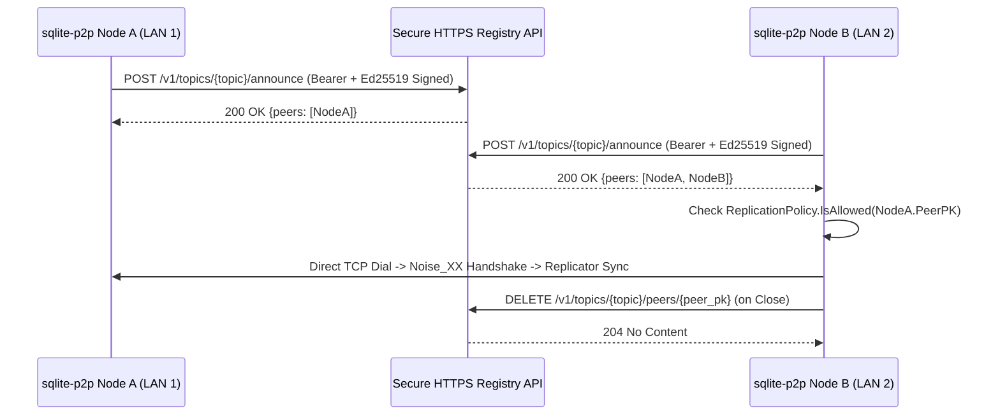

# Coding Agent Specification: Secure HTTPS Swarm Discovery Registry Server

## 1. Purpose & Context
`sqlite-p2p` nodes discover peers within the same LAN using always-on UDP broadcast beacons (`DefaultBeaconPort = 49736`). Across separate LANs and corporate firewalls where UDP/HyperDHT traffic (`cmd/dht-seed/main.go`) is blocked or undesirable, `sqlite-p2p` supports a configurable `cross_lan_mode` (`"https"` or `"both"`) that communicates with a stateless **Secure HTTPS Swarm Discovery Registry API**.

This document is a self-contained implementation blueprint for an autonomous coding agent tasked with building and testing the **HTTPS Swarm Discovery Registry Server** in Go (or any OpenAPI-compliant runtime) that pairs with the client implemented in [/internal/p2p/https_registry.go](/internal/p2p/https_registry.go) and formalized in [/docs/https-swarm-openapi.yaml](/docs/https-swarm-openapi.yaml).

---

## 2. Architecture & Operational Flow



### Key Responsibilities of the Server
1. **Gateway Bearer Authentication**: Validate `Authorization: Bearer <api_key>` against one or more configured API tokens (when token auth is enabled).
2. **Cryptographic Request Verification**: Verify every request's `X-Peer-Public-Key`, `X-Peer-Signing-Key`, `X-Peer-Timestamp`, and `X-Peer-Signature` headers using `crypto/ed25519` and `crypto/sha256`.
3. **Optional Server-Side Replication Gating**: Optionally enforce a server-side `policy.ReplicationPolicy` (`all`, `whitelist`, `blacklist`) against the caller's 32-byte `X-Peer-Public-Key`.
4. **TTL-Bounded Topic Peer Registry**: Maintain an in-memory (or SQLite/Redis-backed) map of `(topic_hex, peer_pk_hex) -> PeerRecord` with automatic TTL expiration.
5. **NAT / Public IP Inference**: If a client announces an unspecified or private IP (or `0.0.0.0:<port>`) and the server is configured to infer public IPs, substitute the client's observed source IP (`X-Forwarded-For` / `RemoteAddr`) while preserving the announced listening TCP port.

---

## 3. Authentication & Ed25519 Signature Verification Specification

### 3.1 Required HTTP Headers
Every client request from `sqlite-p2p` sends:
- `Authorization: Bearer <api_key>` (optional if server runs in open-gateway mode; required when server specifies API keys).
- `X-Peer-Public-Key`: 64-character lowercase hex string representing the node's 32-byte Swarm/Noise public key (`secretstream.KeyPair.Public`).
- `X-Peer-Signing-Key`: 64-character lowercase hex string representing the node's 32-byte Ed25519 public key derived from `ed25519.NewKeyFromSeed(KeyPair.Private[:])`.
- `X-Peer-Timestamp`: Base-10 integer string of the UTC Unix timestamp in seconds when the request was signed.
- `X-Peer-Signature`: 128-character lowercase hex string representing the 64-byte `ed25519` signature.

### 3.2 Canonical String Construction
The canonical string signed by the client is constructed as:
```text
<UPPERCASE_HTTP_METHOD> + "\n" + <REQUEST_URI_PATH_AND_QUERY> + "\n" + <X-Peer-Timestamp> + "\n" + <LOWERCASE_HEX_SHA256_OF_RAW_BODY>
```
- If the request has an empty body (e.g., `GET` or `DELETE`), `<LOWERCASE_HEX_SHA256_OF_RAW_BODY>` is the SHA-256 of `""`:
  `e3b0c44298fc1c149afbf4c8996fb92427ae41e4649b934ca495991b7852b855`
- `<REQUEST_URI_PATH_AND_QUERY>` is `req.URL.RequestURI()` (e.g., `/v1/topics/0123...cdef/peers?exclude_pk=aaaa...`).

### 3.3 Reference Verification Algorithm (Go)
```go
func VerifyRequest(req *http.Request, body []byte, now time.Time, maxSkew time.Duration) ([32]byte, error) {
	var zeroPK [32]byte
	peerPKHex := strings.TrimSpace(req.Header.Get("X-Peer-Public-Key"))
	peerPKBytes, err := hex.DecodeString(peerPKHex)
	if err != nil || len(peerPKBytes) != 32 {
		return zeroPK, errors.New("invalid X-Peer-Public-Key")
	}
	var peerPK [32]byte
	copy(peerPK[:], peerPKBytes)

	signingPKHex := strings.TrimSpace(req.Header.Get("X-Peer-Signing-Key"))
	if signingPKHex == "" {
		signingPKHex = peerPKHex
	}
	signingPKBytes, err := hex.DecodeString(signingPKHex)
	if err != nil || len(signingPKBytes) != ed25519.PublicKeySize {
		return zeroPK, errors.New("invalid X-Peer-Signing-Key")
	}

	tsStr := strings.TrimSpace(req.Header.Get("X-Peer-Timestamp"))
	tsSec, err := strconv.ParseInt(tsStr, 10, 64)
	if err != nil {
		return zeroPK, errors.New("invalid X-Peer-Timestamp")
	}
	if maxSkew <= 0 {
		maxSkew = 5 * time.Minute
	}
	skew := now.Sub(time.Unix(tsSec, 0))
	if skew < 0 {
		skew = -skew
	}
	if skew > maxSkew {
		return zeroPK, errors.New("timestamp outside allowed skew window")
	}

	sigBytes, err := hex.DecodeString(strings.TrimSpace(req.Header.Get("X-Peer-Signature")))
	if err != nil || len(sigBytes) != ed25519.SignatureSize {
		return zeroPK, errors.New("invalid X-Peer-Signature")
	}

	sum := sha256.Sum256(body)
	pathAndQuery := req.URL.RequestURI()
	if pathAndQuery == "" {
		pathAndQuery = "/"
	}
	canonical := strings.ToUpper(req.Method) + "\n" + pathAndQuery + "\n" + tsStr + "\n" + hex.EncodeToString(sum[:])
	if !ed25519.Verify(ed25519.PublicKey(signingPKBytes), []byte(canonical), sigBytes) {
		return zeroPK, errors.New("signature verification failed")
	}
	return peerPK, nil
}
```

### 3.4 Identity Binding Rules
1. On `POST /v1/topics/{topic}/announce`, `body.peer_pk` MUST match `X-Peer-Public-Key` (case-insensitive hex). If they differ, return `403 Forbidden`.
2. On `DELETE /v1/topics/{topic}/peers/{peer_pk}`, path parameter `{peer_pk}` MUST match `X-Peer-Public-Key`. If they differ, return `403 Forbidden`.
3. Once a `peer_pk` is registered in a topic with a given `signing_pk`, subsequent mutations for that active `peer_pk` MUST present the same `signing_pk` until the record expires or is deleted.

---

## 4. Endpoint Contracts

Full schemas are defined in [/docs/https-swarm-openapi.yaml](/docs/https-swarm-openapi.yaml). Summary of behavioral requirements:

### 4.1 `GET /v1/health`
- Validates authentication headers (or optionally allows unauthenticated liveness probes if configured).
- Returns `200 OK`:
  ```json
  {
    "status": "ok",
    "server_time": 1700000000
  }
  ```

### 4.2 `POST /v1/topics/{topic}/announce`
- **Path Parameter**: `{topic}` must be a 64-character hex string (32 bytes). Return `400 Bad Request` otherwise.
- **Request Body**:
  ```json
  {
    "peer_pk": "64-char-hex",
    "signing_pk": "64-char-hex",
    "node_id": "node-A",
    "endpoints": ["203.0.113.10:49737"],
    "ttl_sec": 60,
    "policy_mode": "all"
  }
  ```
- **Server Processing**:
  1. Clamp `ttl_sec` to `[15, 3600]` (default `60`).
  2. Validate each endpoint is a valid `host:port` with `1 <= port <= 65535`.
  3. Upsert `PeerRecord` with `updated_at = now.Unix()` and `expires_at = now.Unix() + granted_ttl`.
  4. Evict any expired peer records on the topic (`expires_at <= now.Unix()`).
  5. Return `200 OK` with all active `PeerRecord` entries for `{topic}`:
     ```json
     {
       "topic": "64-char-hex",
       "ttl_sec": 60,
       "peers": [
         {
           "peer_pk": "64-char-hex",
           "signing_pk": "64-char-hex",
           "node_id": "node-A",
           "endpoints": ["203.0.113.10:49737"],
           "updated_at": 1700000000,
           "expires_at": 1700000060
         }
       ]
     }
     ```

### 4.3 `GET /v1/topics/{topic}/peers`
- **Query Parameters**:
  - `exclude_pk` (optional): 64-char hex `peer_pk` to omit from the returned `peers` slice.
  - `limit` (optional): Max records to return (default `100`, max `500`).
- **Response (`200 OK`)**:
  ```json
  {
    "topic": "64-char-hex",
    "peers": [...]
  }
  ```

### 4.4 `DELETE /v1/topics/{topic}/peers/{peer_pk}`
- Verifies `{peer_pk}` equals `X-Peer-Public-Key`.
- Deletes the peer record from `{topic}` (idempotent if already absent).
- Returns `204 No Content`.

---

## 5. Storage & Concurrency Model
- **In-Memory Store (Default)**:
  - `map[string]map[string]PeerRecord` (`topicHex -> peerPKHex -> PeerRecord`) guarded by `sync.RWMutex`.
  - Background reaper goroutine running every `15s` to prune entries where `ExpiresAt <= time.Now().Unix()`.
- **Optional SQLite / Redis Persistence**:
  - Single table `swarm_peers (topic TEXT, peer_pk TEXT, signing_pk TEXT, node_id TEXT, endpoints_json TEXT, updated_at INTEGER, expires_at INTEGER, PRIMARY KEY (topic, peer_pk))` indexed on `(topic, expires_at)`.

---

## 6. Acceptance Test Checklist for the Server Coding Agent
1. **Unit Test — Signature Verification**:
   - Valid Ed25519 signature within `±300s` returns `200 OK`.
   - Tampered body, wrong `X-Peer-Signing-Key`, or timestamp older than `300s` returns `401 Unauthorized`.
2. **Unit Test — Identity Binding**:
   - Announcing `body.peer_pk` different from `X-Peer-Public-Key` returns `403 Forbidden`.
   - Deleting `{peer_pk}` different from `X-Peer-Public-Key` returns `403 Forbidden`.
3. **Unit Test — TTL Expiration**:
   - Peer announced with `ttl_sec: 15` is returned before expiration and omitted after `16s`.
4. **Integration Test with `sqlite-p2p` Client**:
   - Point `sqlite-p2p`'s `HTTPSRegistryClient` ([/internal/p2p/https_registry.go](/internal/p2p/https_registry.go)) or `Engine` (`CrossLANMode: "https"`, [/pkg/config/config.go](/pkg/config/config.go)) at the server and verify `Health`, `Announce`, `LookupPeers`, and `Unannounce` succeed end-to-end.
