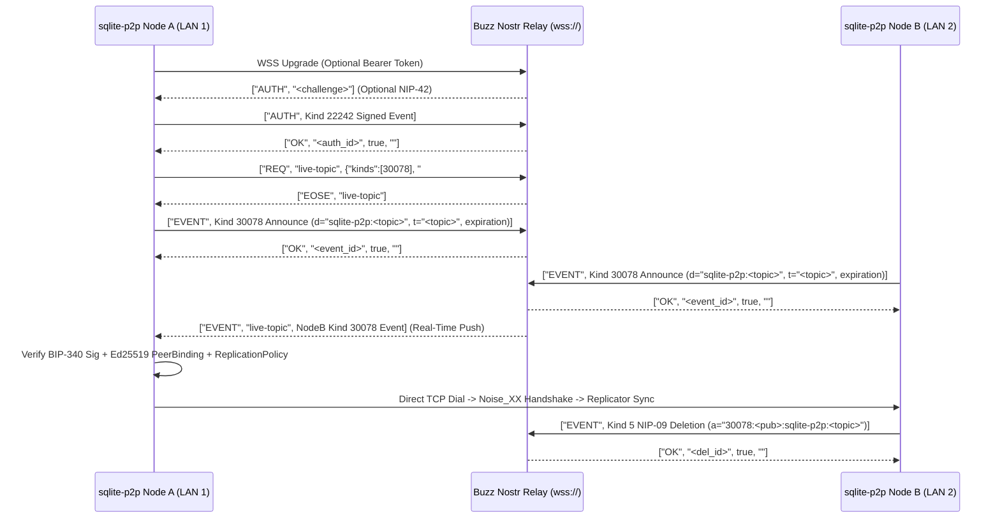

# Coding Agent Specification: Custom Domain Buzz Nostr Relay Server (`wss://`)

## 1. Purpose & Context

`sqlite-p2p` nodes discover peers within the same LAN using always-on UDP broadcast beacons (`DefaultBeaconPort = 49736`). Across separate LANs and corporate firewalls where UDP/HyperDHT traffic (`cmd/dht-seed/main.go`) is blocked or undesirable, `sqlite-p2p` supports a configurable `cross_lan_mode` (`"nostr"` or `"both"`) implemented via the `CrossLANDiscoveryClient` interface and `NostrDiscoveryClient` in [/internal/p2p/nostr_discovery.go](/internal/p2p/nostr_discovery.go).

This document is a self-contained implementation blueprint for an autonomous coding agent tasked with building and testing the **Buzz Nostr Relay Server** as a standalone project that pairs with `sqlite-p2p` and conforms to [/docs/nostr-buzz-relay-protocol.yaml](/docs/nostr-buzz-relay-protocol.yaml).

---

## 2. Supported Nostr NIPs & Operational Flow

The **Buzz Nostr Relay** implements a focused, high-performance subset of the Nostr protocol over `wss://` (WebSocket Secure over HTTPS):

- **NIP-01**: Basic protocol flow (`EVENT`, `REQ`, `CLOSE`, `OK`, `EOSE`, `CLOSED`, `NOTICE`) and BIP-340 `secp256k1` Schnorr signature verification.
- **NIP-09**: Event deletion (`kind: 5`) supporting both `e` (event ID) and `a` (`30078:<pubkey>:sqlite-p2p:<topic_hex>`) coordinate tags for immediate peer unannouncement on `Engine.Close()`.
- **NIP-11**: Relay Information Document returned when an HTTP client sends `GET /` with `Accept: application/nostr+json`.
- **NIP-33**: Parameterized Replaceable Events (`kind: 30078`), storing only the newest event per `(pubkey, kind, d-tag)` tuple.
- **NIP-40**: Expiration Timestamp (`["expiration", "<unix_sec>"]`), automatically rejecting or evicting expired peer presence announcements.
- **NIP-42**: Authentication of clients to relays (`["AUTH", "<challenge>"]` and `kind: 22242`), plus optional `Authorization: Bearer <api_key>` gateway verification on WebSocket upgrade.



---

## 3. Cryptographic Verification Specification

Every peer announcement (`kind: 30078`) carries **two layers of cryptographic proof**:

1. **Layer 1 — Nostr NIP-01 Event Signature (`secp256k1` BIP-340 Schnorr)**:
   - Deterministic key derivation in `sqlite-p2p`:
     `nostr_priv = sha256("sqlite-p2p:nostr:v1:" || secretstream.KeyPair.Private[:])`
   - Canonical event ID:
     `id = hex(sha256(json([0, pubkey, created_at, kind, tags, content])))` (UTF-8, compact JSON, no HTML escaping).
   - `sig` is a 64-byte (128-hex-char) BIP-340 Schnorr signature over `id` verified against the 32-byte x-only `pubkey`.

2. **Layer 2 — Swarm Peer Identity Binding (`ed25519`)**:
   - Inside `event.content` (`NostrAnnounceContent`), the announcing node includes `peer_pk` (32-byte Noise/Swarm public key), `signing_pk` (32-byte Ed25519 public key derived from the same `KeyPair`), and `peer_sig` (64-byte Ed25519 signature).
   - The canonical string signed by `signing_pk` is:
     ```text
     sqlite-p2p:peer-binding:v1
     <lowercase_nostr_pubkey_hex>
     <lowercase_topic_hex>
     <lowercase_peer_pk_hex>
     <comma_joined_endpoints>
     <created_at_base10>
     ```
   - Both the Buzz Relay (if enforcing strict swarm validation) and every receiving `sqlite-p2p` peer verify this Ed25519 signature via `VerifyPeerBinding` in [/internal/p2p/nostr_discovery.go](/internal/p2p/nostr_discovery.go) so no rogue Nostr key can spoof another node's `peer_pk`.

---

## 4. Buzz Relay Storage & Replaceable Event Rules

### 4.1 NIP-33 Parameterized Replaceable Storage (`kind: 30078`)

- Keyed by `(pubkey, kind, d_tag)` where `d_tag` is `"sqlite-p2p:" + topic_hex`.
- When a new `kind: 30078` event arrives:
  1. Verify NIP-01 `id` and BIP-340 `sig`.
  2. Verify NIP-40 `expiration` tag is in the future (`expiration > now.Unix()`), and clamp maximum TTL to `[15, 3600]` seconds if configured.
  3. Optionally verify Layer-2 `VerifyPeerBinding` on `content`.
  4. Compare `created_at` against any existing stored event for `(pubkey, 30078, d_tag)`:
     - Replace if `new.created_at > old.created_at` (or if equal, replace when `new.id < old.id` lexical order per NIP-01/NIP-33, or allow same-second updates from the same peer).
  5. Broadcast `["EVENT", <sub_id>, <event>]` immediately to all active WebSocket connections with a matching subscription filter (`kinds` includes `30078` and `#t` matches `topic_hex`).

### 4.2 NIP-09 Deletion (`kind: 5`)

- When a `kind: 5` event arrives:
  1. Verify NIP-01 `id` and BIP-340 `sig`.
  2. For each `["e", "<event_id>"]` tag: delete any stored event with `id == <event_id>` if and only if `stored.pubkey == deletion_event.pubkey`.
  3. For each `["a", "30078:<pubkey>:sqlite-p2p:<topic_hex>"]` tag: if `<pubkey> == deletion_event.pubkey`, remove the replaceable record for `(pubkey, 30078, "sqlite-p2p:<topic_hex>")` where `stored.created_at <= deletion_event.created_at`.
  4. Respond with `["OK", <del_event_id>, true, ""]`.

### 4.3 NIP-40 Background Expiration Reaper

- Run a background ticker every `15s` that evicts any stored event whose `expiration` tag is `<= time.Now().Unix()`.
- Never return expired events in response to `REQ` queries.

### 4.4 NIP-11 Relay Information Document & Health Check

- On `GET /` with `Accept: application/nostr+json`:
  ```json
  {
    "name": "Buzz Nostr Relay",
    "description": "Custom domain Nostr relay for sqlite-p2p cross-LAN discovery",
    "supported_nips": [1, 9, 11, 33, 40, 42],
    "software": "buzz-relay",
    "version": "1.0.0"
  }
  ```
- On `GET /health` (or `GET /v1/health`):
  ```json
  {
    "status": "ok",
    "server_time": 1700000000
  }
  ```

---

## 5. Acceptance Test Checklist for the Buzz Relay Coding Agent

1. **Unit Test — BIP-340 & NIP-01 Event Verification**:
   - Valid `kind: 30078` event signed by `SignNostrEvent` returns `["OK", "<id>", true, ""]`.
   - Tampered `content`, mismatched `id`, or invalid Schnorr `sig` returns `["OK", "<id>", false, "invalid: signature verification failed"]`.
2. **Unit Test — NIP-33 Replaceable Deduplication**:
   - Publishing two `kind: 30078` events from the same `pubkey` and `["d", "sqlite-p2p:<topic>"]` retains only the newest event when queried via `["REQ", "sub1", {"kinds":[30078], "#t":["<topic>"]}]`.
3. **Unit Test — Real-Time Subscription Push**:
   - Client A subscribes via `REQ` and receives `EOSE`; when Client B publishes a matching `kind: 30078` event, Client A immediately receives `["EVENT", "<sub_id>", <event>]` over its open WebSocket.
4. **Unit Test — NIP-40 Expiration & NIP-09 Unannounce**:
   - Event with `["expiration", "<past_ts>"]` is rejected or omitted from `REQ`.
   - Publishing a `kind: 5` event with `["a", "30078:<pubkey>:sqlite-p2p:<topic>"]` removes the peer's announcement immediately.
5. **Integration Test with `sqlite-p2p`**:
   - Point `sqlite-p2p`'s `NostrDiscoveryClient` ([/internal/p2p/nostr_discovery.go](/internal/p2p/nostr_discovery.go)) or `Engine` (`CrossLANMode: "nostr"`, [/pkg/config/config.go](/pkg/config/config.go)) at the Buzz Relay server and verify end-to-end cross-LAN peer discovery and SQLite replication.
